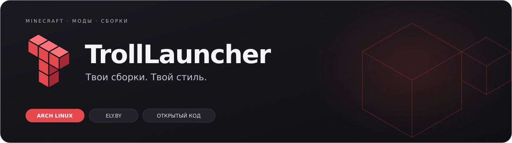
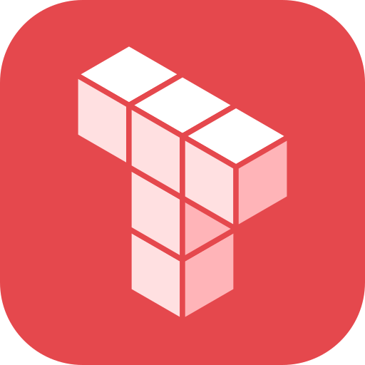

<p align="center">
	
</p>

<p align="center">
	<b>Всё для Minecraft в одном лаунчере.</b><br>
	Сборки и моды, вход через Ely.by и интерфейс, который можно настроить под себя.
</p>

<p align="center">
	<a href="https://github.com/Flenstick/TrollLauncher/releases/latest"></a>
	<a href="#установка"></a>
	<a href="apps/app/LICENSE"></a>
</p>

<p align="center">
	<a href="https://github.com/Flenstick/TrollLauncher/releases/latest"><b>Скачать лаунчер ↗</b></a>
	&nbsp; · &nbsp;
	<a href="#возможности">Возможности</a>
	&nbsp; · &nbsp;
	<a href="https://github.com/Flenstick/TrollLauncher/issues/new?template=bug.yml">Сообщить об ошибке</a>
	&nbsp; · &nbsp;
	<a href="https://github.com/Flenstick/TrollLauncher/issues/new?template=idea.yml">Предложить идею</a>
</p>

<br>

<p align="center">
	<a href=".github/media/screenshot-browse.png"></a>
	<br>
	<sub>Находи сборки, выбирай моды и устанавливай их прямо из лаунчера.</sub>
</p>

## Возможности

<table>
	<tr>
		<td width="50%" valign="top">
			<h3>📦 Minecraft со всеми модами</h3>
			<p>Каталог Modrinth: сборки, моды, шейдеры и ресурспаки. Fabric, Forge, NeoForge и Quilt, импорт <code>.mrpack</code> и автоматическая загрузка Java.</p>
		</td>
		<td width="50%" valign="top">
			<h3>🎨 Твой интерфейс</h3>
			<p>Светлая и тёмная основа, цветовые палитры и свой акцент. Логотип меняет цвет вместе с темой. Русский язык по умолчанию.</p>
		</td>
	</tr>
	<tr>
		<td valign="top">
			<h3>🔑 Вход через Ely.by</h3>
			<p>Авторизация по нику или почте, поддержка двухфакторной аутентификации и скинов Ely.by. Запуск игры через authlib-injector.</p>
		</td>
		<td valign="top">
			<h3>🔎 Удобный размер и шрифт</h3>
			<p>Масштаб от 80 до 150 %, горячие клавиши и шрифт на выбор: Inter, Golos Text, системный или свой установленный.</p>
		</td>
	</tr>
	<tr>
		<td valign="top">
			<h3>🖥️ Под рукой, даже в фоне</h3>
			<p>Трей с последними сборками, остановкой игры и временем в игре. Настраиваемые автозапуск, поведение крестика и клик по иконке.</p>
		</td>
		<td valign="top">
			<h3>✨ Внимание к деталям</h3>
			<p>На Linux снято ограничение WebKitGTK в 60 FPS. Реклама, телеметрия и сбор ошибок выключены.</p>
		</td>
	</tr>
</table>

## Установка

Готовая сборка доступна для **Arch Linux и производных · x86_64**: CachyOS, EndeavourOS, Manjaro.

```sh
curl -fsSL https://raw.githubusercontent.com/Flenstick/TrollLauncher/main/install.sh | bash
```

Запускай без `sudo`: установщик сам запросит пароль для pacman, соберёт пакет `trolllauncher-bin`
и установит зависимости. После установки TrollLauncher появится в меню приложений.
**Для обновления выполни ту же команду.**

> Другие платформы: готовых сборок для Windows и macOS пока нет. Архив этого релиза не поддерживает встроенное автообновление.

<details>
<summary><b>Ручная установка и скачивание архива</b></summary>

Через PKGBUILD:

```sh
git clone --depth 1 https://github.com/Flenstick/TrollLauncher
cd TrollLauncher/packaging/arch
makepkg -si
```

Или скачай архив со [страницы релизов](https://github.com/Flenstick/TrollLauncher/releases/latest).
Внутри — бинарник `trolllauncher`, ярлык `.desktop`, иконки и лицензия.
Архив требует системных библиотек; их список указан в [PKGBUILD](packaging/arch/PKGBUILD).

</details>

<details>
<summary><b>Удаление и сохранение данных</b></summary>

```sh
curl -fsSL https://raw.githubusercontent.com/Flenstick/TrollLauncher/main/install.sh | bash -s -- --uninstall
```

Сборки, миры и настройки сохранятся в `~/.local/share/TrollLauncher`.

</details>

## Быстрые команды

Добавь команды в горячие клавиши своей среды рабочего стола. Они работают и на Wayland.

| Команда | Действие |
| --- | --- |
| `trolllauncher --toggle` | Показать или скрыть окно |
| `trolllauncher --launch-last` | Запустить последнюю сборку |
| `trolllauncher --show` | Показать окно |

Масштаб интерфейса: <kbd>Ctrl</kbd> + <kbd>+</kbd> / <kbd>−</kbd>,
сброс: <kbd>Ctrl</kbd> + <kbd>0</kbd>. Горячие клавиши масштаба можно отключить в настройках.

## Разработка

TrollLauncher — форк [Modrinth App](https://github.com/modrinth/code), построенный на **Tauri, Rust и Vue**.

<details>
<summary><b>Собрать и запустить из исходников</b></summary>

Нужны Rust из [`rust-toolchain.toml`](rust-toolchain.toml), Node.js ≥ 24.15 и pnpm 12.8.1.
Команды ниже — для Arch Linux и производных.

```sh
sudo pacman -S --needed base-devel webkit2gtk-4.1 libayatana-appindicator librsvg nodejs pnpm rustup
git clone https://github.com/Flenstick/TrollLauncher
cd TrollLauncher
pnpm install
cp packages/app-lib/.env.prod packages/app-lib/.env
```

Запуск в режиме разработки:

```sh
pnpm app:dev
```

Сборка исполняемого файла:

```sh
cd apps/app
pnpm tauri build --no-bundle
```

Результат: `target/release/trolllauncher` относительно корня репозитория.

| Где | Что находится |
| --- | --- |
| [`apps/app`](apps/app) | Оболочка Tauri и Rust |
| [`apps/app-frontend`](apps/app-frontend) | Интерфейс Vue |
| [`packages/app-lib`](packages/app-lib) | Общая библиотека лаунчера |
| [`packaging`](packaging) | Установка и упаковка для Linux |

</details>

Нашёл ошибку — [расскажи, как её повторить](https://github.com/Flenstick/TrollLauncher/issues/new?template=bug.yml).
Есть идея — [предложи её здесь](https://github.com/Flenstick/TrollLauncher/issues/new?template=idea.yml).

---

<p align="center">
	<br>
	<b>TrollLauncher</b><br>
	<sub>На основе Modrinth App · <a href="apps/app/LICENSE">GPL-3.0</a> · <a href="COPYING.md">Лицензии компонентов</a></sub>
</p>

<sub>Независимый проект, не связанный с Modrinth, Rinth, Inc., Mojang или Microsoft.
Minecraft — товарный знак Mojang AB. Компоненты монорепозитория распространяются под своими лицензиями.</sub>
