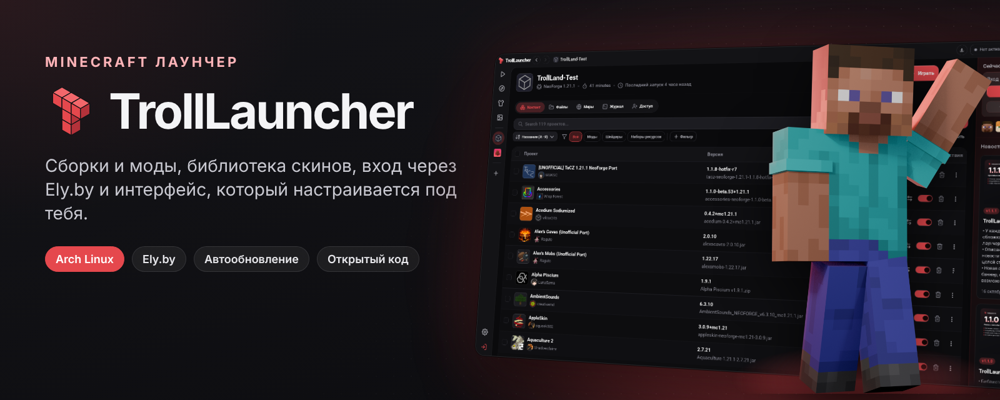
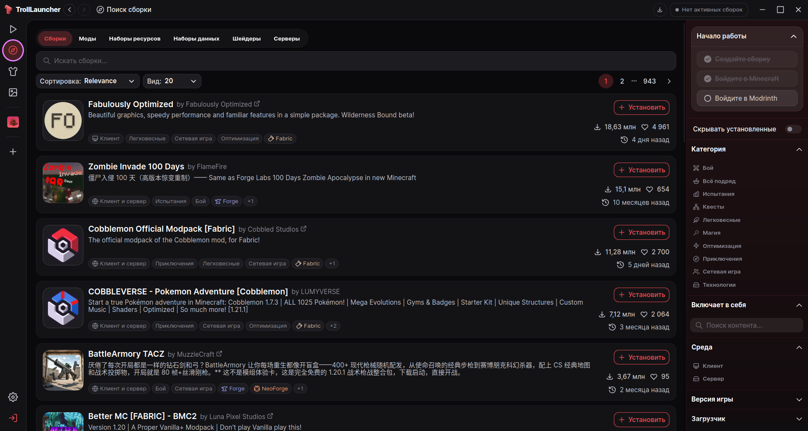

<p align="center">
  
</p>

<p align="center">
  <b>Лаунчер Minecraft со сборками, модами, темами и входом через Ely.by</b><br>
  <sub>Форк Modrinth App с упором на настройку под себя</sub>
</p>

<p align="center">
  <a href="https://github.com/Flenstick/TrollLauncher/releases/latest"></a>
  
  <a href="apps/app/LICENSE"></a>
</p>

<p align="center">
  
</p>

## Установка

Arch Linux и производные (CachyOS, EndeavourOS, Manjaro):

```sh
curl -fsSL https://raw.githubusercontent.com/Flenstick/TrollLauncher/main/install.sh | bash
```

Скрипт соберёт пакет `trolllauncher-bin` и поставит его через pacman вместе с зависимостями.
После установки лаунчер появится в меню приложений. Обновление — та же команда.

<details>
<summary>Удаление и ручная установка</summary>

Удалить:

```sh
curl -fsSL https://raw.githubusercontent.com/Flenstick/TrollLauncher/main/install.sh | bash -s -- --uninstall
```

Сборки и миры остаются в `~/.local/share/TrollLauncher`.

Вручную через PKGBUILD:

```sh
git clone --depth 1 https://github.com/Flenstick/TrollLauncher
cd TrollLauncher/packaging/arch
makepkg -si
```

Или скачайте архив со [страницы релизов](https://github.com/Flenstick/TrollLauncher/releases/latest):
внутри бинарник `trolllauncher`, ярлык `.desktop` и иконки.

</details>

## Возможности

**Всё, что умеет Modrinth App** — каталог сборок, модов, шейдеров и ресурспаков, установка в один клик,
Fabric / Forge / NeoForge / Quilt, импорт `.mrpack`, Java скачивается сама.

**Темы.** Набор цветовых палитр, свой акцентный цвет, светлая и тёмная основа. Логотип перекрашивается
под тему.

**Интерфейс под себя.** Масштаб 80–150 % (ползунок или <kbd>Ctrl</kbd> <kbd>+</kbd> / <kbd>−</kbd> / <kbd>0</kbd>),
шрифт на выбор: Inter, Golos Text, системный или любой установленный. Русский язык по умолчанию.

**Ely.by.** Вход по нику или почте с поддержкой 2FA, скины и головы с Ely.by, запуск через
authlib-injector — играть можно без лицензии Microsoft.

**Трей и фон.** Иконка с меню: последние сборки, остановка игры, время в игре. Что делает крестик,
клик по иконке, автозапуск — всё настраивается. Команды для горячих клавиш (работают и на Wayland):

```sh
trolllauncher --toggle        # показать или скрыть окно
trolllauncher --launch-last   # запустить последнюю сборку
trolllauncher --show          # показать окно
```

**Плавность.** На Linux снят лимит в 60 FPS у WebKitGTK — прокрутка и анимации идут с частотой
монитора, в том числе на NVIDIA.

**Без лишнего.** Реклама, телеметрия и сбор ошибок выключены.

## Сборка из исходников

Нужны Rust (версия из `rust-toolchain.toml`), Node.js, pnpm и зависимости Tauri:

```sh
sudo pacman -S --needed base-devel webkit2gtk-4.1 libayatana-appindicator librsvg nodejs pnpm rustup
git clone https://github.com/Flenstick/TrollLauncher && cd TrollLauncher
pnpm install
cp packages/app-lib/.env.prod packages/app-lib/.env

pnpm app:dev                              # запуск в режиме разработки
cd apps/app && pnpm tauri build --no-bundle   # бинарник: target/release/trolllauncher
```

Код лаунчера — `apps/app` (Rust, Tauri) и `apps/app-frontend` (Vue). Общая библиотека — `packages/app-lib`.

## Лицензия

TrollLauncher основан на [Modrinth App](https://github.com/modrinth/code) и распространяется
под **GPL-3.0**, как и оригинал. Проект не связан с Modrinth и Rinth, Inc.; товарные знаки и логотипы
Modrinth из форка удалены. Подробности — в [COPYING.md](COPYING.md).

Minecraft — товарный знак Mojang AB. Проект не связан с Mojang и Microsoft.
