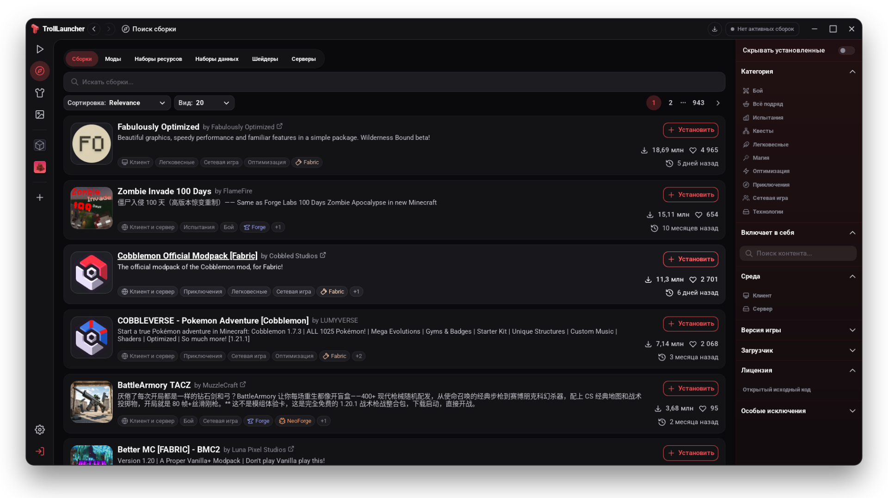
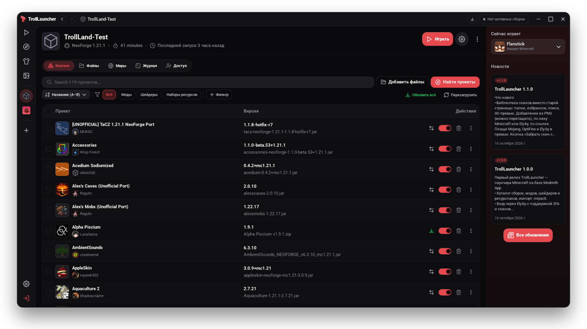
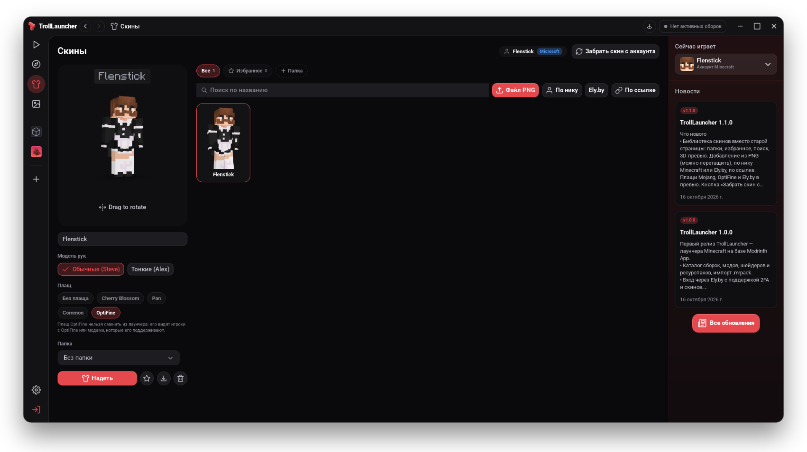
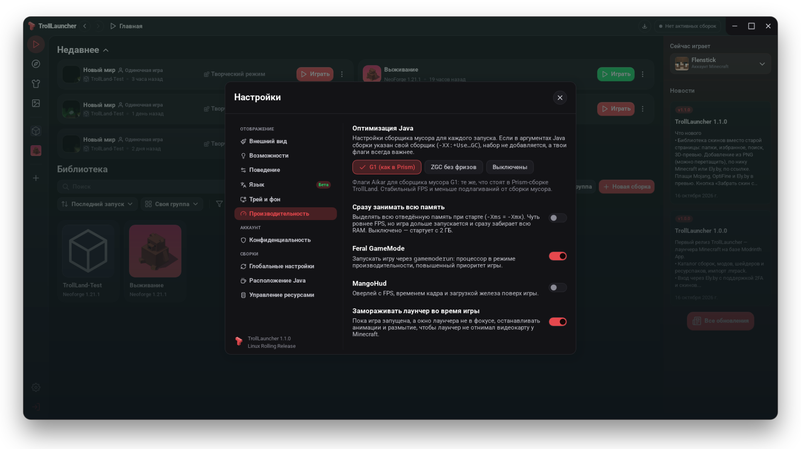
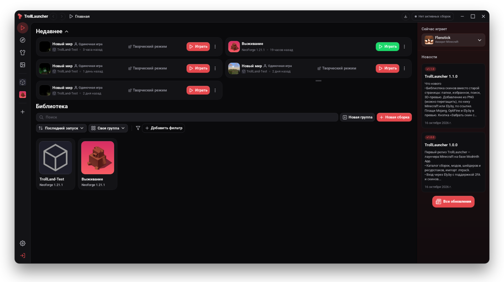

<p align="center">
	<a href="https://github.com/Flenstick/TrollLauncher/releases/latest"></a>
</p>

<p align="center">
	<a href="https://github.com/Flenstick/TrollLauncher/releases/latest"></a>
	<a href="#установка"></a>
	<a href="https://github.com/Flenstick/TrollLauncher/releases"></a>
	<a href="apps/app/LICENSE"></a>
</p>

<h3 align="center">
	<a href="#установка">Установить</a>
	&nbsp;·&nbsp;
	<a href="#возможности">Возможности</a>
	&nbsp;·&nbsp;
	<a href="https://github.com/Flenstick/TrollLauncher/releases">Что нового</a>
	&nbsp;·&nbsp;
	<a href="https://github.com/Flenstick/TrollLauncher/issues/new?template=idea.yml">Идея</a>
	&nbsp;·&nbsp;
	<a href="https://github.com/Flenstick/TrollLauncher/issues/new?template=bug.yml">Ошибка</a>
</h3>

<br>

**TrollLauncher** — лаунчер Minecraft на основе Modrinth App, переделанный под игроков: каталог сборок и модов,
библиотека скинов с плащами, вход через Ely.by, настройки производительности как в Prism и обновления в один клик.
Без рекламы и телеметрии, на русском языке с первого запуска.

```sh
curl -fsSL https://raw.githubusercontent.com/Flenstick/TrollLauncher/main/install.sh | bash
```

<br>

## Возможности

### 📦 Сборки и моды в пару кликов

Весь каталог Modrinth: сборки, моды, шейдеры, ресурспаки и сервера. Fabric, Forge, NeoForge и Quilt,
импорт `.mrpack`, обновление модов одной кнопкой и автоматическая загрузка нужной Java.

<p align="center"></p>

### 🧱 Всё о сборке на одной странице

Моды, файлы, миры и журнал игры. Список из сотен модов прокручивается плавно —
в TrollLauncher убраны эффекты, из-за которых он тормозил.

<p align="center"></p>

### 👕 Библиотека скинов

Храни сколько угодно скинов, раскладывай по папкам и отмечай избранные — они появятся
в боковой панели для смены в один клик. Добавляй PNG перетаскиванием, по нику Minecraft или Ely.by
или по ссылке. В 3D-превью видны плащи Mojang, OptiFine и Ely.by.

<p align="center"></p>

### ⚡ Больше FPS в игре

Раздел «Производительность»: оптимизированные флаги Java (G1 как в Prism или ZGC без фризов),
Feral GameMode, MangoHud и пауза анимаций лаунчера, пока ты играешь.

<p align="center"></p>

### 🎨 Интерфейс под себя

Светлая и тёмная тема, палитры и свой акцентный цвет, масштаб от 80 до 150 % и шрифт на выбор:
Inter, Golos Text, системный или любой установленный.

<p align="center"></p>

### И ещё

<table>
	<tr>
		<td width="33%" valign="top">
			<h4>🔑 Ely.by</h4>
			Вход по нику или почте с двухфакторной защитой, скины Ely.by в игре через authlib-injector.
		</td>
		<td width="33%" valign="top">
			<h4>🔄 Автообновление</h4>
			Лаунчер сам находит новую версию и ставит её по кнопке. Архив проверяется по SHA-256, во время игры ничего не трогается.
		</td>
		<td width="33%" valign="top">
			<h4>🖥️ Трей</h4>
			Последние сборки, остановка игры и время в игре прямо из трея. Автозапуск и команды для горячих клавиш.
		</td>
	</tr>
	<tr>
		<td valign="top">
			<h4>📰 Новости</h4>
			Каждое обновление — с обложкой и списком изменений прямо в боковой панели.
		</td>
		<td valign="top">
			<h4>🔒 Приватность</h4>
			Реклама, телеметрия и сбор ошибок выключены. Никаких аккаунтов Modrinth не требуется.
		</td>
		<td valign="top">
			<h4>🐧 Сделан для Linux</h4>
			Снято ограничение WebKitGTK в 60 FPS, работает на Wayland, ставится обычным пакетом pacman.
		</td>
	</tr>
</table>

## Установка

Готовая сборка — для **Arch Linux и производных, x86_64**: CachyOS, EndeavourOS, Manjaro.

```sh
curl -fsSL https://raw.githubusercontent.com/Flenstick/TrollLauncher/main/install.sh | bash
```

Запускай без `sudo`: установщик сам спросит пароль, соберёт пакет `trolllauncher-bin` и поставит зависимости.
После установки TrollLauncher появится в меню приложений. Дальше он **обновляется сам** — кнопка появится
в верхней панели, когда выйдет новая версия.

> Для Windows и macOS готовых сборок пока нет.

<details>
<summary><b>Ручная установка</b></summary>

```sh
git clone --depth 1 https://github.com/Flenstick/TrollLauncher
cd TrollLauncher/packaging/arch
makepkg -si
```

Или скачай архив со [страницы релизов](https://github.com/Flenstick/TrollLauncher/releases/latest):
внутри бинарник `trolllauncher`, ярлык, иконки и лицензия. Системные библиотеки перечислены в [PKGBUILD](packaging/arch/PKGBUILD).

</details>

<details>
<summary><b>Удаление</b></summary>

```sh
curl -fsSL https://raw.githubusercontent.com/Flenstick/TrollLauncher/main/install.sh | bash -s -- --uninstall
```

Сборки, миры, скины и настройки останутся в `~/.local/share/TrollLauncher`.

</details>

## Горячие клавиши

Назначь команды на любые сочетания в своей среде рабочего стола — работают и на Wayland.

| Команда | Действие |
| --- | --- |
| `trolllauncher --toggle` | Показать или скрыть окно |
| `trolllauncher --launch-last` | Запустить последнюю сборку |
| `trolllauncher --show` | Показать окно |

Масштаб интерфейса: <kbd>Ctrl</kbd> <kbd>+</kbd> / <kbd>Ctrl</kbd> <kbd>−</kbd>, сброс — <kbd>Ctrl</kbd> <kbd>0</kbd>.

## Разработка

TrollLauncher — форк [Modrinth App](https://github.com/modrinth/code) на **Tauri, Rust и Vue**.

<details>
<summary><b>Собрать из исходников</b></summary>

Нужны Rust из [`rust-toolchain.toml`](rust-toolchain.toml), Node.js ≥ 24.15 и pnpm 12.8.1.

```sh
sudo pacman -S --needed base-devel webkit2gtk-4.1 libayatana-appindicator librsvg nodejs pnpm rustup
git clone https://github.com/Flenstick/TrollLauncher
cd TrollLauncher
pnpm install
cp packages/app-lib/.env.prod packages/app-lib/.env
pnpm app:dev                                   # режим разработки
cd apps/app && pnpm tauri build --no-bundle    # сборка: target/release/trolllauncher
```

| Где | Что |
| --- | --- |
| [`apps/app`](apps/app) | Оболочка Tauri и Rust |
| [`apps/app-frontend`](apps/app-frontend) | Интерфейс Vue |
| [`packages/app-lib`](packages/app-lib) | Ядро лаунчера |
| [`packaging`](packaging) | Пакеты для Linux |
| [`design/github`](design/github) | Баннер, обложки релизов и скриншоты для этой страницы |

</details>

<details>
<summary><b>Выпуск релиза</b></summary>

1. Поднять версию в `apps/app/Cargo.toml`, `apps/app-frontend/package.json` и `packaging/arch/PKGBUILD`.
2. Собрать: `cd apps/app && pnpm tauri build --no-bundle`, затем `packaging/linux/make-tarball.sh`.
3. Рядом с архивом положить `trolllauncher-X.Y.Z-x86_64.tar.gz.sha256` (`sha256sum архив > архив.sha256`) и вписать сумму в PKGBUILD.
4. Обложка: добавить версию в [`design/github/releases.json`](design/github/releases.json) и запустить `python3 design/github/render.py X.Y.Z`.
5. Коммит, тег `vX.Y.Z`, релиз с архивом и `.sha256`. Первой строкой описания — ``: эта картинка станет обложкой новости в лаунчере.

Слово `[critical]` в описании помечает обновление как важное.

</details>

Нашёл ошибку — [расскажи, как её повторить](https://github.com/Flenstick/TrollLauncher/issues/new?template=bug.yml).
Есть идея — [предложи её](https://github.com/Flenstick/TrollLauncher/issues/new?template=idea.yml).

---

<p align="center">
	<br>
	<b>TrollLauncher</b><br>
	<sub>На основе Modrinth App · <a href="apps/app/LICENSE">GPL-3.0</a> · <a href="COPYING.md">Лицензии компонентов</a></sub>
</p>

<sub>Независимый проект, не связанный с Modrinth, Rinth, Inc., Mojang или Microsoft.
Minecraft — товарный знак Mojang AB. Компоненты монорепозитория распространяются под своими лицензиями.</sub>
